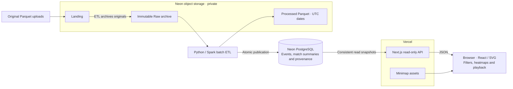

# Architecture

Let’s follow a gameplay recording from its source file to the map. We prepare the data separately, so a level designer can open the tool and start exploring.

## Choosing Our Stack

- **Next.js, React, TypeScript:** we keep the interface/API together and share typed contracts. SVG overlays draw journeys, events, and heatmaps.
- **Neon PostgreSQL:** related tables organize maps, matches, participants, and events. Indexes make filtering efficient.
- **Python/Spark:** one batch pipeline validates and transforms Parquet. Private S3-compatible storage retains originals and processed files.
- **Deployment:** Vercel hosts the app; Neon provides database/storage. Docker Compose supports development and separate ingestion. The hosted tool works independently of our development machine.

## Following the Data



1. **First, receive the files.** Uploads enter Landing. We archive originals unchanged so we can revisit them and trace each record’s source.
2. **Next, prepare the records.** Spark decodes labels, validates fields, and calculates coordinates. We keep the earliest identical file copy; file hashes and original row numbers preserve event identities. Processed Parquet follows UTC event dates.
3. **Then, publish the changes.** We rebuild affected matches and skip unchanged inputs. Updates commit together, so a failed import leaves existing events intact.
4. **Now, display the recording.** APIs return metrics, heatmap grids, and timestamp-grouped events from consistent database snapshots. Playback uses loaded records without requesting data for every frame.

## Placing a Player on the Map

We use world **X/Z** for the top-down position. **Y remains elevation.** Each map’s origin and scale come from [config/maps.json](config/maps.json):

```text
u = (x − origin_x) / scale; v = (z − origin_z) / scale
image_x = u × rendered_width; image_y = (1 − v) × rendered_height
```

The `1 − v` flips the vertical axis to match the image’s top-left origin. For example, Ambrose Valley’s `(−301.45, −355.55)` becomes approximately `(78, 890)` on a 1024×1024 reference image. We use the supplied maps’ actual aspect ratios when drawing overlays.

## Reading the Data Carefully

Before interpreting what we see, we need a few conventions:

- **Time:** we treat source integers as epoch seconds despite their millisecond label; recorded spans of 13–890 seconds support this choice. UTC event dates drive filters, including recordings that cross midnight.
- **Identity and counts:** UUIDs identify humans; numeric IDs identify bots within matches. Kill credit follows the recorded actor. Each Loot row counts as one item. Repeated combat rows remain included; unique-incident interpretation is unresolved.
- **Playback:** simultaneous records stay together. We skip between timestamps, avoid interpolation, break trails across gaps over 15 seconds, and retain post-death positions without inferring respawn.
- **Coverage:** we show recorded participants, not complete lobbies. Traffic counts samples, not time spent. Opponents, extraction outcomes, and storm boundaries remain unknown.

## Tradeoffs We Accepted

| Choice | What we gain / accept |
| --- | --- |
| Spark batch processing | One repeatable pipeline; extra runtime overhead for this small dataset. |
| Stored match summaries and indexed events | Fast catalogue queries; summaries publish atomically with events. Detailed metrics remain on demand. |
| Free hosting and manual ingestion | Independent web availability at low cost; uploads need an ETL run. |

The analysis and experiments behind these choices are in [Insights](INSIGHTS.md).

## Availability and Scalability

We keep exploration separate from preparation, then reduce the work needed to serve each request:

- **Availability:** Vercel and Neon serve the tool independently of our development machine and ingestion worker. Atomic publication keeps previously published recordings intact when an import fails.
- **Request load:** stateless API handlers can run across multiple web instances. Database capacity still determines how many queries we can serve together.
- **Match discovery:** stored summaries avoid recounting raw events. Search and participant filters run on the server; the interface loads 50 choices at a time.
- **Playback:** we index journeys once and reuse SVG paths. A browser check retained all 50,000 positions across 100 synthetic participants; it was not a concurrency benchmark.
- **Current limits:** history-wide file discovery, one ingestion job, and full-recording playback responses still constrain growth. Failover and sustained-load testing are needed before claiming high availability or large-scale capacity.

### Growth Scenario

Let’s consider **10 million downloads**, **3 million active accounts**, and **1 million daily players**, with an unconstrained AWS budget:

- **Matches:** assuming 10 matches per player daily and 100 human players per match, `1 million × 10 ÷ 100 = 100,000 matches/day`.
- **Events:** at 50,000 events per match, we receive **5 billion events/day**, averaging about **58,000 events/second**, with higher peaks.
- **Storage:** our sample footprints project roughly **470 GB/day of compressed source Parquet** and **3.3 TB/day in the current indexed PostgreSQL layout**. These are small-sample estimates; compression, schema, additional copies, and backups affect actual storage.

### Proposed Improvements

For this workload, we would extend the pipeline and serving design together:

1. **Incremental file discovery:** use [S3 notifications and SQS](https://docs.aws.amazon.com/AmazonS3/latest/userguide/notification-how-to-event-types-and-destinations.html) with durable processing receipts. Process new arrivals, tolerate duplicate notifications and late files, preserve copy-selection rules, and run periodic archive audits. Our current file-per-player/match layout would produce about **10 million files/day** in this scenario.
2. **Distributed compute:** adapt Spark jobs for [Amazon EMR](https://docs.aws.amazon.com/emr/latest/ManagementGuide/emr-overview-arch.html), reading and writing S3 directly. Replace local staging and fixed partition limits with workload-based partitioning and file compaction.
3. **Parallel publication:** replace the global ingestion lock and single publication stream with bounded, independently owned match batches. Keep retries safe and publish events and summaries atomically.
4. **Storage and queries:** keep bulk history in partitioned Parquet with an analytical query layer, following an [AWS game analytics pattern](https://docs.aws.amazon.com/wellarchitected/latest/games-industry-lens/game-analytics-pipeline.html). Use PostgreSQL for catalogues, summaries, and bounded recent match data, with explicit retention.
5. **Playback and resilience:** fetch playback in timestamp-grouped chunks, configure database failover, and test peak traffic, ingestion backlogs, and recovery.

EMR provides distributed processing; achieving **5 billion events/day end to end** remains a target to validate through sizing and load tests. These improvements are proposed, not implemented.

## TODO: Cloud Capacity Assessment

- [ ] **9 November 2026:** Estimate how much data the current design can handle on a minimal-cost Azure or AWS setup. Define the compute, database, and storage configuration and monthly cost. Assess total data volume, ingestion throughput, playback size, and concurrent usage. Document assumptions, bottlenecks, and the testing needed to validate the estimates.
