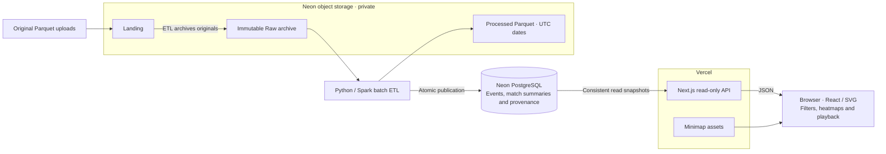

# Architecture

Let’s follow a gameplay recording from its source file to the map. We prepare the data separately, so a level designer can open the tool and start exploring.

## Choosing Our Stack

- **Next.js, React, TypeScript:** one interface/API with shared contracts. SVG draws journeys, events, and heatmaps.
- **Neon PostgreSQL:** related tables organize gameplay records; indexes support filtering.
- **Python/Spark:** batch validation and transformation of Parquet; private S3-compatible storage retains originals and processed files.
- **Deployment:** Vercel hosts the app; Neon provides database/storage. Docker Compose supports development and separate ingestion; the hosted tool works independently of our machine.

## Following the Data



1. **First, receive the files.** Uploads enter Landing; we archive originals unchanged for tracing and reprocessing.
2. **Next, prepare the records.** Spark decodes labels, validates records, and maps coordinates. We keep the earliest identical file copy; hashes and physical row numbers preserve identities. Processed Parquet follows UTC dates.
3. **Then, publish the changes.** We rebuild affected matches, skip unchanged inputs, and commit updates together; failed imports leave published events intact.
4. **Now, display the recording.** APIs return metrics, heatmaps, and timestamp groups from consistent snapshots. Loaded records drive playback without a request per frame.

## Placing a Player on the Map

We use world **X/Z** for the top-down position. **Y remains elevation.** Each map’s origin and scale come from [config/maps.json](config/maps.json):

```text
u = (x − origin_x) / scale; v = (z − origin_z) / scale
image_x = u × rendered_width; image_y = (1 − v) × rendered_height
```

The `1 − v` flips the vertical axis to match the image’s top-left origin. For example, Ambrose Valley’s `(−301.45, −355.55)` becomes approximately `(78, 890)` on a 1024×1024 reference image. We use the supplied maps’ actual aspect ratios when drawing overlays.

## Reading the Data Carefully

Before interpreting what we see, we need a few conventions:

- **Time:** we treat source integers as epoch seconds despite their millisecond label; recorded spans of 13–890 seconds support this choice. UTC event dates drive filters, including recordings that cross midnight.
- **Identity and counts:** UUIDs identify humans; numeric IDs identify bots within matches. Kill credit follows the recorded actor. Each Loot row counts as one item. Repeated combat rows remain included; unique-incident interpretation is unresolved.
- **Playback:** simultaneous records stay together. We skip between timestamps, avoid interpolation, break trails across gaps over 15 seconds, and retain post-death positions without inferring respawn.
- **Coverage:** we show recorded participants, not complete lobbies. Traffic counts samples, not time spent. Opponents, extraction outcomes, and storm boundaries remain unknown.

## Tradeoffs We Accepted

| Choice | What we gain / accept |
| --- | --- |
| Spark batch processing | One repeatable pipeline; extra runtime overhead for this small dataset. |
| Stored match summaries and indexed events | Fast catalogue queries; summaries publish atomically with events. Detailed metrics remain on demand. |
| Free hosting and manual ingestion | Independent web availability at low cost; uploads need an ETL run. |

The analysis and experiments behind these choices are in [Insights](INSIGHTS.md).

## Availability and Scalability

We separate exploration from preparation and reduce work per request:

- **Availability:** hosted serving runs independently of our development machine and ingestion worker. Atomic publication protects existing recordings from failed imports.
- **Request load:** stateless APIs support multiple web instances; database capacity still governs query concurrency.
- **Match discovery:** stored summaries and server-side filters avoid recounting raw events; the interface loads 50 choices per page.
- **Playback:** indexed journeys reuse SVG paths. A browser check retained 50,000 positions across 100 synthetic participants; concurrency remains unbenchmarked.
- **Current limits:** history-wide discovery, one ingestion job, and full-recording responses constrain growth. Failover and sustained-load tests must validate availability and capacity.

### Growth Scenario

Let’s consider **10 million downloads**, **3 million active accounts**, and **1 million daily players**, with an unconstrained AWS budget:

- **Matches:** assuming 10 matches per player daily and 100 human players per match, `1 million × 10 ÷ 100 = 100,000 matches/day`.
- **Events:** at 50,000 events per match, we receive **5 billion events/day**, averaging about **58,000 events/second**, with higher peaks.
- **Storage:** our sample footprints project roughly **470 GB/day of compressed source Parquet** and **3.3 TB/day in the current indexed PostgreSQL layout**. These are small-sample estimates; compression, schema, additional copies, and backups affect actual storage.

### Proposed Improvements

For this workload, we would extend ingestion and serving together:

1. **Incremental file discovery:** use [S3 notifications and SQS](https://docs.aws.amazon.com/AmazonS3/latest/userguide/notification-how-to-event-types-and-destinations.html) with durable processing receipts. Handle new arrivals, duplicate notifications and late files, retain copy-selection rules, and audit archives periodically. The current file-per-player/match layout produces about **10 million files/day** in this scenario.
2. **Distributed compute:** adapt Spark for [Amazon EMR](https://docs.aws.amazon.com/emr/latest/ManagementGuide/emr-overview-arch.html) with direct S3 reads/writes, workload-based partitioning, and file compaction instead of local staging and fixed limits.
3. **Parallel publication:** replace the global lock and single publication stream with bounded match batches, safe retries, and atomic event/summary publication.
4. **Storage and queries:** keep bulk history in partitioned Parquet with [analytical queries](https://docs.aws.amazon.com/wellarchitected/latest/games-industry-lens/game-analytics-pipeline.html); use PostgreSQL for catalogues, summaries, and bounded recent matches with explicit retention.
5. **Playback and resilience:** fetch playback in timestamp-grouped chunks, configure database failover, and test peak traffic, ingestion backlogs, and recovery.

These changes are proposed. **Five billion events/day end to end** remains a target requiring sizing and load tests.

## TODO: Cloud Capacity Assessment

- [ ] **9 November 2026:** Estimate minimal-cost Azure/AWS compute, database, storage, and monthly cost; assess retention, ingestion, playback, and concurrency. Record assumptions, bottlenecks, and validation tests.
